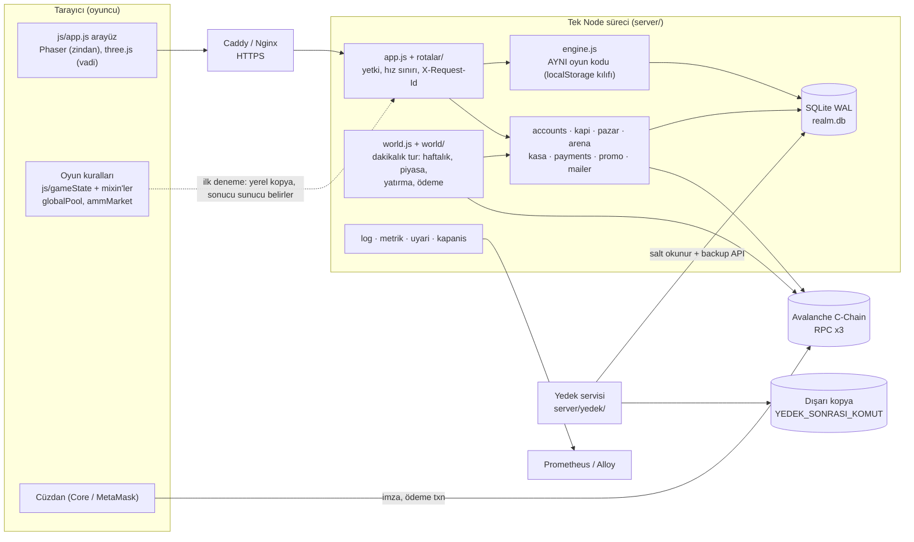
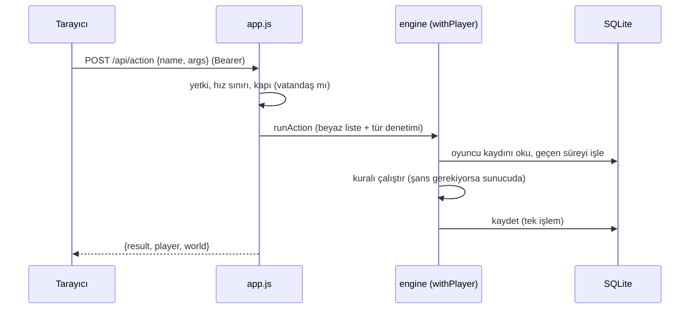
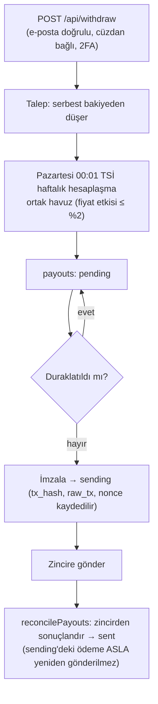
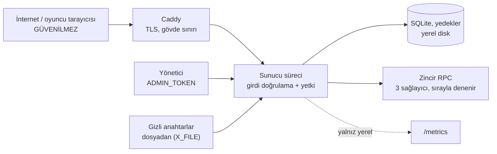

# Mimari

Realm of AdAstra: tarayıcıda oynanan strateji/RPG; kurallar tarayıcıda **ve** aynı kodla sunucuda çalışır; ADASTRA token'ı ile Avalanche üzerinde ödeme/çekim yapılır. Bu belge "ne nerede, veri nasıl akar, kime ne kadar güveniliyor, nerede sınırlar var" sorularını cevaplar. Karar gerekçeleri `docs/kurumsal/ADR/`, sayılar `docs/kurumsal/METRIKLER.md` ve `PERFORMANS.md`.

## 1. Bileşenler

- **Tek süreç, tek yazan.** Sunucu bilerek tek Node sürecidir; `withPlayer` eşzamanlıdır (iki istek iç içe geçmez), bu yüzden kilit/yarış sorunu yoktur. Sınırı ve büyüme yolu 6. bölümde.
- **Oyun motoru iki yerde.** Kurallar (`js/`) tarayıcıda çalışır; sunucu aynı dosyaları `server/engine.js` ile içe alır (sahte `localStorage` → SQLite `kv` tablosu). Oyuncu bir işlem yapınca sunucu **kendi kopyasında** çalıştırır ve sonucu yanıtlar; tarayıcıdaki hesap yalnızca anlık görüntü içindir. Şansa bağlı işlemler (`random: true`) yalnız sunucuda çözülür.
- **Beyaz liste.** Tarayıcının gönderebileceği işlemler `server/actions.js` içindedir (66 işlem, argüman türleri tek tek denetlenir); hile/test işlemleri yalnız deneme kipinde. Liste `docs/openapi.yaml` ile kayma testiyle bağlıdır.

## 2. Kod yerleşimi

| Yer | Ne |
|---|---|
| `js/` | Oyun kuralları ve arayüz. `gameState.js` 254 yöntemi 20 karışıma (`js/gameState/*.js`) bölünmüş ince bir çekirdektir; `js/app.js` tek arayüz denetleyicisidir (bölünmesi ertelendi: ADR 0005) |
| `server/index.js` | Bağlama sırası: ayar → günlük/ölümcül hata → veritabanı → motor → zincir → posta → hesaplar → arena → kasa → kapı → ilan pazarı → dünya → ödemeler → uygulama → zamanlayıcılar → düzgün kapanış |
| `server/app.js`, `server/rotalar/` | HTTP: rota tablosu (`'YÖNTEM /yol'`), yetki (`acik` / `oyuncu` / `yonetici`), hız sınırları, başlıklar, istek kimliği, `/metrics` |
| `server/world.js`, `server/world/` | Dakikalık tur ve haftalık hesaplaşma, piyasa, yatırma, ödeme kuyruğu (`pending → sending → sent`), dünya bossu, ortak gelir, sıcak cüzdan |
| `server/db.js`, `server/gecis/` | SQLite + mühürlü, ileri yönlü şema geçişleri (`schema_migrations`) |
| `server/yedek/` | Yedekleme, doğrulama, geri yükleme, komut satırı araçları |
| `contracts/` | `RealmPayments` (ödeme), `RealmRates` (oranlar, 24 sa gecikmeli) |
| `deploy/`, `Dockerfile`, `docker-compose*.yml` | Çalıştırma paketi: Docker ya da systemd, Caddy, alarm kuralları |
| `scripts/` | Araçlar: kapılar (`kontrol`, `gizli-tara`, `audit-uretim`), yük testi (`yuk/`), belge üreticileri |

## 3. Veri akışları

### 3.1 Oyun işlemi

Hata olursa işlem geri alınır ve bellekteki dünya yeniden yüklenir (`safePlayer`); oyuncuya ham hata gitmez, günlükte istek kimliğiyle aranır.

### 3.2 Yatırma ve cüzdandan ödeme
Oyuncu `RealmPayments.pay(amount, ref)` çağırır (ADASTRA hazineye, AVAX ücreti komisyon cüzdanına). Tarayıcı `POST /api/pay/confirm {ref, txHash}` gönderir; sunucu işlemi **zincirden doğrular** (tutar, ref, alıcı), `tx_hash` tekil olduğu için aynı işlem iki kez sayılmaz, sonra oyun işlemini uygular. Zincirde henüz görünmüyorsa 409 + `retry`.

### 3.3 Çekim ve ödeme

Güvenlik kemerleri: haftalık gönderim üst sınırı (`WEEKLY_SEND_CAP_ADA`), duraklatma bayrağı, oyun cüzdanında yalnız ~1 haftalık ihtiyaç (fazlası günlük olarak donanım cüzdanına), sözleşme sahibi donanım cüzdanında.

### 3.4 Dakikalık tur (`world.tick`)
Epoch bitmişse haftalık hesaplaşma; dünya bossu; piyasa fiyatı (saatlik); yatırma taraması (2 dk); kapı kuralı ve ilan süresi dolumu (saatlik); Kasa bakiyeleri/işlemleri (2/5 dk); ödemeler (5 dk); oran sözleşmesi, ortak gelir (5 dk); sıcak cüzdan (günlük). Tur takılırsa `/api/ready` 503 verir; üst üste hata e-posta uyarısı üretir.

## 4. Güven sınırları

- **Tarayıcı hiçbir şeyi belirlemez:** tutar, şans, ödeme sonucu, eşya nesnesi sunucuda yeniden hesaplanır/doğrulanır; yalnız eşyanın *konumu* gönderilir.
- **Oturum:** 32 baytlık rastgele anahtar; veritabanında yalnız SHA-256 özeti. Parola `scrypt` (versiyonlu özet, girişte yükseltme). Ayrıntı: `docs/kurumsal/OWASP.md`, ADR 0004.
- **Gizli bilgi:** `GAME_WALLET_PRIVATE_KEY`, `KASA_MASTER_KEY`, `ADMIN_TOKEN`, `SMTP_URL`, `YEDEK_ANAHTAR` ortamda değil dosyada (`*_FILE`); günlükte maskelenir; yedek sonrası komutuna verilmez.
- **Kasa:** oyuncu başına sunucunun yönettiği adres; özel anahtarlar AES-GCM ile `KASA_MASTER_KEY` altında saklanır; bakiye üst sınırı aşan kısım otomatik oyuncunun cüzdanına döner.
- **Yönetici uçları** ayrı yetki sınıfıdır, yanlış denemeler IP başına bekletilir, her değiştirici işlem denetim izine yazılır.

## 5. Bağımlılıklar

Üretimde yalnız 3 paket: `ethers` (zincir), `nodemailer` (SMTP), `qrcode` (2FA QR). Veritabanı Node'un kendi `node:sqlite` modülüdür (Node 24). Derleme/test araçları (`vite`, `phaser`, `three`, `eslint`, `c8`, `knip`, `ganache`, `solc`, `yaml`) yalnız geliştirme bağımlılığıdır; üretim `node_modules`'i ≈21 MB, dist dahil bütün çalışma ağacı ≈37 MB'tır. Üretim bağımlılıklarının açığı CI'da (`npm run audit-uretim`) denetlenir.

## 6. Sınırlar ve ölçekleme yolu

| Sınır | Neden | Ne zaman aşılır / ne yapılır |
|---|---|---|
| Tek süreç, tek yazan | Basitlik; yarış durumu yok | Ölçüm: `docs/kurumsal/PERFORMANS.md` (500 ve 2.000 eşzamanlı bağlantıda hata 0; 30 dk dayanıklılıkta hata 0, bellek düz). Olay döngüsü gecikmesi p99 > 200 ms sürekli ise (alarm `RealmOlayDongusuGeciKiyor`) ilk adım profil çıkarıp ağır işi ayırmak |
| SQLite | Kurulumsuz, atomik, yedeklenmesi kolay (ADR 0001) | Veritabanı > 5 GB (alarm `RealmVeritabaniBuyuk`) ya da yazma gecikmesi sürekli yüksek; o zaman PostgreSQL'e geçiş (eşikler ADR 0001'de). Şema geçişleri ve sorgu planı kapısı bunu kolaylaştırır |
| Redis / dış önbellek yok | Ölçüm gerektirmedi (ADR 0002) | Yatay ölçek (çok süreç) gerekirse oturum/hız sınırı/dünya durumu paylaşılan depoya taşınmalı |
| Aynı makinede yedek | Basitlik | Dışarı kopya (`YEDEK_SONRASI_KOMUT`) ŞART; ayrıntı `FELAKET_KURTARMA.md` |
| Zincir RPC'ye bağımlılık | Fiyat, yatırma, ödeme | 3 RPC sırayla denenir; kesintide oyun sürer, para işleri bekler |
| `js/app.js` büyük (≈8,7 bin satır) | Bölmenin riski/kazancı dengesiz bulundu (ADR 0005) | Arayüz işine başlamadan önce Playwright duman testi kurup dilim dilim bölmek |
